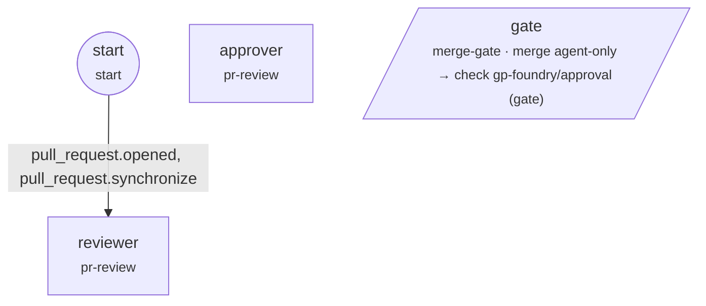

<!-- GENERATED FROM harness.dot — DO NOT EDIT. Run `gp-foundry build`. -->

# bot-authors — agent harness

## Triggers

| Workflow | Runs on |
|----------|---------|
| `reviewer` | pull_request: opened, synchronize, ready_for_review, labeled · schedule: `*/15 * * * *` · workflow_dispatch |
| `approver` | schedule: `*/10 * * * *` · workflow_dispatch |
| `gate` | schedule: `*/10 * * * *` · workflow_dispatch · pull_request: synchronize, reopened, ready_for_review, labeled, unlabeled, review_requested, review_request_removed · pull_request_review: submitted, dismissed |
